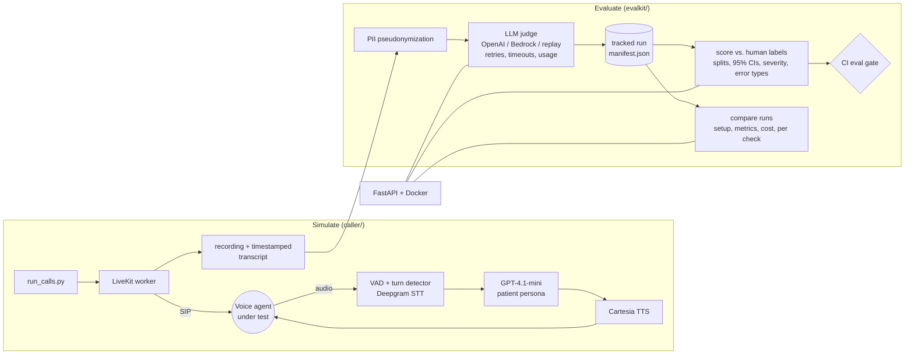

# llm-voice-agent-eval

[](https://github.com/yding-lab/llm-voice-agent-eval/actions/workflows/tests.yml)  [](LICENSE)

**An evaluation platform for voice AI agents.** It simulates realistic users over real phone calls, grades every call with an LLM judge, measures that judge against human labels with confidence intervals, tracks every run as a reproducible experiment, and serves the whole pipeline over an API.

The agent under test here is an AI receptionist for a medical clinic. The caller bot plays a patient across 15 scenarios and grades the agent against 66 numbered checks. It runs on LiveKit Agents in pipeline mode (Deepgram STT → GPT-4.1-mini → Cartesia TTS) over a Twilio SIP trunk. The judge runs on OpenAI or AWS Bedrock.

## Try it in 60 seconds, no keys

The evaluation half runs on the 11 recorded calls with no API keys, phone line or LiveKit account. Its `replay` mode serves the recorded judge outputs, so the scores and reports you see are the real ones, at no cost.

```bash
docker build -t llm-voice-agent-eval . && docker run --rm -p 8000:8000 llm-voice-agent-eval
# open http://localhost:8000/docs  ->  POST /samples/02-new_patient_booking/evaluate  ->  "Try it out"
```

Or without Docker:

```bash
pip install -r requirements-eval.txt
python -m evalkit demo      # replay the judge on all 11 calls and score it against human labels
make serve                  # the same API at http://127.0.0.1:8000/docs
```

## How it fits together



## Highlights

- **The evaluator is evaluated.** The LLM judge was scored against human-confirmed findings: **50% precision (95% CI 27–73%)** and **56% recall (27–81%)** at baseline. Every error traced to one of four causes (blaming the wrong side, no clock, lenient grading, a coverage gap), and judge v2 targets each one. See [JUDGE_EVAL.md](JUDGE_EVAL.md).
- **Honest about sample size.** Every rate comes with a Wilson interval. Metrics are split into `dev` (the calls v2 was designed on, so in-sample) and `holdout` (every new call). A second reviewer's labels give Cohen's κ, and the labelling template and agreement command are already in place.
- **Every run is a tracked experiment.** Each run records its provider, model, rubric hash, scenario-set hash, input hashes, git commit, tokens, estimated cost and latency in `manifest.json`. `compare` shows what changed in the setup, the scores, the cost, and check by check.
- **One pipeline, production habits.** Pseudonymize → judge → save → score → report, with layered config, retries with exponential backoff, timeouts, per-call error isolation, resumable runs and per-call logging.
- **A service, not just scripts.** The FastAPI endpoints evaluate a transcript, list runs and compare them, packaged as a non-root Docker image that CI builds and smoke-tests on every push.
- **Responsible AI by default.** Names, dates of birth, phones and emails become stable tokens before any model call, so the judge can still see that a correction was ignored without ever seeing the values.
- **Real calls, real bugs.** 11 calls to a live demo agent turned up 9 confirmed issues, including a critical one: records were matched on caller ID, so a second caller from the same number could see and cancel another patient's appointment ([BUG_REPORT.md](BUG_REPORT.md)).
- **Natural turn-taking.** A semantic end-of-turn model on top of VAD, a tool for staying silent during "one moment, let me check", and guards against hanging up mid-question. Median response latency was **1.31 s** over 110 turns.

| Doc | What's in it |
|---|---|
| [JUDGE_EVAL.md](JUDGE_EVAL.md) | How good is the LLM judge? Method, results with intervals, error analysis, v2, limits |
| [ARCHITECTURE.md](ARCHITECTURE.md) | Both halves of the system, every design decision with alternatives and trade-offs |
| [BUG_REPORT.md](BUG_REPORT.md) | 9 issues found in the demo agent, by severity, each cited to a call and timestamp |
| [ITERATION_LOG.md](ITERATION_LOG.md) | What went wrong, the real cause, the fix and how it was tested |
| [calls/](calls/INDEX.md) | 11 real calls: recordings, timestamped transcripts |

## Evaluation pipeline (`evalkit`)

```bash
python -m evalkit demo                                    # keyless replay + scoring
python -m evalkit run --name judge-v2                     # judge all calls with the configured model (OPENAI_API_KEY)
python -m evalkit run --provider bedrock --model <bedrock model id> --name v2-bedrock   # AWS credentials
python -m evalkit score --run evals/runs/judge-v2         # precision / recall per split, CIs, severity, error types
python -m evalkit compare evals/runs/baseline-v1-gpt-4.1 evals/runs/judge-v2
python -m evalkit runs -v                                 # every tracked run with model, rubric, cost, latency
python -m evalkit labels-template                         # blank sheet for a second reviewer
python -m evalkit agreement                               # Cohen's kappa once a second reviewer has labelled
```

Settings come from `evals/config.yaml`, then environment variables (`ANALYSIS_PROVIDER`, `ANALYSIS_MODEL`, `EVAL_RUBRIC`, …), then CLI flags. The resolved values are saved with every run.

**What a run records** (`evals/runs/<run>/manifest.json`):

| Field | Why |
|---|---|
| `config` (provider, model, rubric, redaction, timeouts, retries) | So a result can be traced to the exact settings |
| `rubric_sha`, `scenario_set_sha`, per-call `input_sha` | An edited prompt or transcript can't pass for the version that was scored |
| `git_commit`, `created_at`, `evalkit_version` | Reproducibility |
| per call: `status`, `error`, `attempts`, `latency_s`, tokens, `cost_usd`, `redactions` | Reliability, cost and privacy at a glance |
| `totals` | Run-level cost, token, error and latency summary |

## API

`uvicorn evalkit.api:app` or `docker run`, with interactive docs at `/docs`:

| Endpoint | Does |
|---|---|
| `GET /health` | Service status, judge provider and model |
| `GET /scenarios`, `GET /samples`, `GET /samples/{call}` | What can be graded, and the bundled recorded calls |
| `POST /evaluate` | Grade a transcript against a scenario id or inline checks. Returns per-check verdicts with evidence, other findings, redaction counts, latency, tokens, cost and a markdown report |
| `POST /samples/{call}/evaluate` | Same for a bundled call, plus its score against the human labels |
| `GET /runs`, `GET /runs/{run}` | Tracked runs, with manifest and scores |
| `GET /compare?before=&after=` | Setup changes, score deltas, cost and latency, check-by-check differences |

The judge provider is fixed by the server's configuration, never by the request, so a public demo can't be used to spend API credits. In replay mode (the image default), only the bundled transcripts can be graded. Set `ANALYSIS_PROVIDER=openai` with a key to grade new ones.

## Real calls

[`calls/INDEX.md`](calls/INDEX.md) lists 11 calls (96–323 s, mean 2.8 min) to a demo AI receptionist for an orthopedic clinic. Start with `calls/02-new_patient_booking` (the critical privacy bug, at 01:01 and 02:33) or `calls/07-barge_in` (a scripted interruption the agent handles well). These calls used an earlier primary-care version of the scenarios; each `scenario.json` records what that call used.

**Known issue in these recordings:** the first ~35 s of several calls overlap. The line plays a recording notice, pauses, then greets, and the bot answered the notice (30 of 33 cut-off bot turns are in that window). After the greeting, turn-taking is normal. The fix, and a guard against hanging up right after a question or during a transfer, came after these calls and are covered by `tests/`; see [ITERATION_LOG.md](ITERATION_LOG.md) #7–#10.

## Placing live calls

Requirements: macOS or Linux, Python 3.11–3.13, and API keys for Deepgram, OpenAI and Cartesia. Real calls also need a LiveKit Cloud project and a Twilio account with one phone number.

```bash
./setup.sh && source .venv/bin/activate             # creates .venv, installs deps, copies .env.example to .env
SCENARIO=refill_routine python -m caller.agent console --text   # rehearse: you type as the receptionist, nothing is dialed

# in .env: LiveKit, Twilio trunk, TARGET_NUMBER and a test patient
python scripts/setup_trunk.py                        # registers the Twilio trunk with LiveKit; copy the id into .env
python scripts/preflight.py                          # checks every key, the trunk and the target without dialing
python scripts/run_calls.py --all                    # every scenario, one after another (--list for ids)
python -m evalkit run                                # judge the calls; new calls are scored as holdout
```

> Only call voice agents you own or have explicit permission to test. The bot dials exactly one configured number and refuses any other.

After every call, the runner checks that it was a real conversation (recording and transcript saved, at least 45 s, at least 3 turns from each side) and updates `calls/INDEX.md`. Each `calls/NN-<scenario>/` holds `recording.mp3` (mono mix), `recording.ogg` (stereo: agent left, bot right), `transcript.txt` with `[mm:ss]` timestamps matching the audio, `transcript.json` (turns plus the bot's per-turn latency) and `scenario.json`.

**Scenarios and checks.** `caller/scenarios.yaml` holds 15 scenarios: booking, new patients, rescheduling, cancellation, refills (routine and controlled), insurance, hours, an emergency disguised as a follow-up, indecisive callers, barge-in, third-party privacy requests and prompt injection. Each has a goal and things to try (which the bot sees), numbered failure conditions with a severity (which it doesn't), and a passing outcome. Five common checks (`GEN-01`–`GEN-05`) apply to every call, for 66 in total. Adding a scenario means adding YAML, not code.

**Telephony (Twilio → LiveKit SIP).**
1. Buy one Twilio number.
2. Create an Elastic SIP trunk with a termination URI and a credential list.
3. Attach the number to the trunk.
4. If the first call fails with `SIP 403 No International Permission`, enable the destination in Twilio's geographic permissions.
5. Run `scripts/setup_trunk.py`.

## Environment variables

All are listed with comments in [`.env.example`](.env.example); secrets live only in `.env`, which is git-ignored.

| Variable | Purpose |
|---|---|
| `ANALYSIS_PROVIDER`, `ANALYSIS_MODEL`, `AWS_REGION` | The judge: `openai` (default, gpt-4.1), `bedrock`, or `replay` (keyless) |
| `EVAL_RUBRIC`, `EVAL_REDACT`, `EVAL_TIMEOUT_S`, `EVAL_MAX_RETRIES`, `EVAL_REPLAY_RUN` | Judge settings that override `evals/config.yaml` |
| `DEEPGRAM_API_KEY`, `OPENAI_API_KEY`, `CARTESIA_API_KEY` | STT, patient LLM and judge, TTS |
| `LIVEKIT_URL`, `LIVEKIT_API_KEY`, `LIVEKIT_API_SECRET`, `SIP_OUTBOUND_TRUNK_ID` | LiveKit Cloud and the outbound trunk |
| `TWILIO_*`, `CALLER_ID_NUMBER` | Used once by `setup_trunk.py` |
| `TARGET_NUMBER` | The voice agent under test, E.164. The only number the bot will dial |
| `PATIENT_FIRST_NAME`, `PATIENT_LAST_NAME`, `PATIENT_DOB`, `PATIENT_PHONE` | The test patient; must match a test account on the system under test |
| `LLM_MODEL`, `STT_MODEL`, `TTS_MODEL`, `TTS_VOICE_ID`, `MIN/MAX_ENDPOINTING_DELAY` | Caller tuning |

## Project layout

```
evalkit/            evaluation pipeline (no LiveKit dependency)
  config.py         layered settings: defaults -> evals/config.yaml -> env -> overrides
  data.py           calls, scenarios, checks, input hashing
  redact.py         PII pseudonymization with stable tokens
  rubrics.py        versioned judge rubrics (v1 kept byte-for-byte for the baseline)
  providers.py      OpenAI, AWS Bedrock (Converse API), replay; token usage
  judge.py          prompt building, retries with backoff, per-call outcome
  pipeline.py       end to end: judge -> save -> score -> report; resumable
  runs.py           experiment tracking: manifest, cost, latency, run listing
  scoring.py        labels, splits, Wilson CIs, severity, error types, Cohen's kappa
  compare.py        run-vs-run: setup, metrics, cost, check-by-check
  api.py            FastAPI service
  cli.py            python -m evalkit ...
evals/
  config.yaml       default judge settings
  labels/           human ground truth (reviewer_a = adjudicated) + template for more reviewers
  splits.yaml       dev (in-sample) vs. holdout
  pricing.yaml      per-1M-token prices for cost estimates
  runs/             tracked judge runs (baseline-v1-gpt-4.1, ...)
caller/             the caller bot: LiveKit worker, persona, scenarios, recording, transcripts
scripts/            run_calls, setup_trunk, preflight, renumber_calls; analyze/eval/compare wrap evalkit
tests/              pytest suite (no keys, no network) + turn-taking guard checks
calls/              recordings and transcripts of the real calls
Dockerfile          the evaluation service image (replay mode by default)
```

## Tests

No API keys and no network. CI runs them on every push, alongside an eval gate (the newest judge run must keep ≥50% precision and recall against human labels) and a Docker build plus smoke test of the running container.

```bash
make test        # pytest suite (pipeline, providers, retries, scoring, tracking, API) + turn-taking guards
make demo        # keyless end-to-end run
```

## Debugging tips

- `python -m caller.agent dev` runs the worker with debug logs; in another shell, `python scripts/run_calls.py --no-worker <scenario>`. Batch-run worker logs are in `logs/worker.log`.
- If the bot talks over the agent's pauses, raise `MIN_ENDPOINTING_DELAY` (for example to 0.9). If it feels sluggish, lower it.
- With no `PATIENT_*` values, console mode uses a fictional patient (Sarah Mitchell, March 15, 1992, +12125550147).
