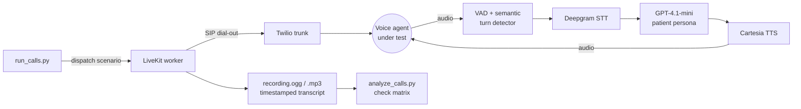

# voice-agent-qa

**Automated phone-call testing for voice AI agents.** A Python bot that phones a voice agent (here, an AI clinic receptionist), plays a realistic patient across 15 scenarios, records and transcribes every call, and grades the agent against 66 numbered checks.

Built on LiveKit Agents in pipeline mode: Deepgram STT → GPT-4.1-mini → Cartesia TTS, dialing out over a Twilio SIP trunk.



## Highlights

- **Real calls, natural turn-taking.** A semantic end-of-turn model on top of VAD, a tool for staying silent during "one moment, let me check", and guards against hanging up mid-question or during a transfer. Median response latency was **1.31 s** across 110 measured turns.
- **Scenarios as data.** Each scenario gives the bot a goal and a few pressure tests to work in naturally (closed days, controlled-substance refills, made-up insurance, emergencies, privacy probes, prompt injection, barge-in), plus failure conditions the bot never sees.
- **Evidence you can cite.** Stereo recording (agent left, bot right) and a transcript on the same timeline, so `[01:23]` in the text is 1:23 in the audio. An LLM first pass grades every check; findings are then confirmed by listening.
- **It found real bugs.** Including a critical one: records matched on caller ID, so a second caller from the same number could see and cancel another patient's appointment. See [BUG_REPORT.md](BUG_REPORT.md).
- **Safe by construction.** The bot dials exactly one configured number and refuses any other destination.

| Doc | What's in it |
|---|---|
| [calls/](calls/INDEX.md) | 11 real calls: recordings, timestamped transcripts, per-call findings |
| [BUG_REPORT.md](BUG_REPORT.md) | 9 issues found in a demo clinic agent, by severity, each cited to a call and timestamp |
| [ARCHITECTURE.md](ARCHITECTURE.md) | How it works, every design decision with the alternatives and trade-offs, measured results |
| [ITERATION_LOG.md](ITERATION_LOG.md) | What went wrong on early calls, the real cause, the fix and how it was tested |

## Real calls

[`calls/INDEX.md`](calls/INDEX.md) lists 11 calls (96–323 s, mean 2.8 min) to a demo AI receptionist for an orthopedic clinic. Start with `calls/02-new_patient_booking` (the critical privacy bug, at 01:01 and 02:33) or `calls/07-barge_in` (a scripted interruption the agent handles well). These calls used an earlier primary-care version of the scenarios; each `scenario.json` records what that call used.

**Known issue in these recordings:** the first ~35 s of several calls overlap. The line plays a recording notice, pauses, then greets, and the bot answered the notice (30 of 33 cut-off bot turns are in that window). After the greeting, turn-taking is normal. The fix, and a guard against hanging up right after a question or during a transfer, came after these calls and are covered by `tests/`; see [ITERATION_LOG.md](ITERATION_LOG.md) #7–#10.

## Quick start

Requirements: macOS or Linux, Python 3.11–3.13 (`brew install python@3.12` on a Mac), and API keys for Deepgram, OpenAI and Cartesia. Real calls also need a LiveKit Cloud project and a Twilio account with one phone number.

```bash
./setup.sh                        # creates .venv, installs deps, copies .env.example to .env
source .venv/bin/activate
python scripts/preflight.py --console
```

**Try it without a phone line.** You play the receptionist, through your mic or by typing. Nothing is dialed, and only the three provider keys are needed:

```bash
SCENARIO=refill_routine python -m caller.agent console --text
```

**Place real calls:**

```bash
# in .env: LiveKit, Twilio trunk, TARGET_NUMBER and a test patient
python scripts/setup_trunk.py                        # registers the Twilio trunk with LiveKit; copy the id into .env
python scripts/preflight.py                          # checks every key, the trunk and the target without dialing
python scripts/run_calls.py --all                    # every scenario, one after another
python scripts/run_calls.py schedule_new_checkup     # one scenario
python scripts/run_calls.py --list                   # scenario ids
python scripts/analyze_calls.py                      # LLM first pass: calls/*/findings.md, reports/check_matrix.md
```

> Only call voice agents you own or have explicit permission to test.

## What each call produces

After every call, the runner checks that it was a real conversation: recording and transcript saved, at least 45 s long, and at least 3 turns from each side. It prints VALID or the reason it isn't, and keeps a table of all calls in `calls/INDEX.md`.

`calls/NN-<scenario>/`

| File | Contents |
|---|---|
| `recording.mp3` | Mono mix of both sides |
| `recording.ogg` | Stereo Opus: left channel is the agent under test, right channel is the bot |
| `transcript.txt` | Both sides with `[mm:ss]` timestamps that match the recording; barge-ins, hangups and tool calls marked |
| `transcript.json` | The same turns in structured form, plus the bot's per-turn response latency |
| `scenario.json` | The goal and expected behaviour used for this call |
| `findings.md` / `.json` | Each check graded pass, fail or not tested (after running the analyzer) |

## Scenarios and checks

`caller/scenarios.yaml` holds 15 scenarios for an orthopedic clinic: booking, new patients, rescheduling, cancellation, refills (routine and controlled), insurance, hours, an emergency disguised as a follow-up, indecisive callers, barge-in, third-party privacy requests and prompt injection. Each has:
- a goal and a few things to try, which the bot sees;
- numbered failure conditions with a severity (for example `SCH-01`: confirms an appointment without checking availability, Critical), which the bot does not see;
- a one-line passing outcome.

Five common checks (`GEN-01` to `GEN-05`: talking over the caller, loops, self-contradiction, false "done" claims, dead air) apply to every call, for 66 checks in total. A scenario can override the caller's identity, opening line and voice, or script a barge-in. Adding a scenario means adding a YAML entry, not code.

## Telephony setup (Twilio → LiveKit SIP)

1. **Buy one Twilio number** and use it for every call.
2. **Create an Elastic SIP trunk.** Under Termination, set a termination SIP URI (this is `TWILIO_TERMINATION_URI`) and add a credential list (`TWILIO_SIP_USERNAME`, `TWILIO_SIP_PASSWORD`).
3. **Attach the number** to the trunk and put it in `CALLER_ID_NUMBER`.
4. **Check geo permissions.** If the first call fails with `SIP 403 No International Permission`, enable the destination in Twilio's voice geographic permissions.
5. **Register the trunk.** Run `python scripts/setup_trunk.py` and put the printed `SIP_OUTBOUND_TRUNK_ID` in `.env`.

## Environment variables

All variables are listed with comments in [`.env.example`](.env.example). Secrets live only in `.env`, which is git-ignored.

| Variable | Purpose |
|---|---|
| `DEEPGRAM_API_KEY`, `OPENAI_API_KEY`, `CARTESIA_API_KEY` | STT, patient LLM and analyzer, TTS |
| `LIVEKIT_URL`, `LIVEKIT_API_KEY`, `LIVEKIT_API_SECRET` | LiveKit Cloud project: rooms, SIP, turn detection |
| `TWILIO_*`, `CALLER_ID_NUMBER` | Used once by `setup_trunk.py` |
| `SIP_OUTBOUND_TRUNK_ID` | LiveKit outbound trunk used to dial |
| `TARGET_NUMBER` | The voice agent under test, E.164. The only number the bot will dial |
| `PATIENT_FIRST_NAME`, `PATIENT_LAST_NAME`, `PATIENT_DOB`, `PATIENT_PHONE` | The test patient; must match a test account on the system under test |
| `LLM_MODEL`, `STT_MODEL`, `TTS_MODEL`, `TTS_VOICE_ID`, `MIN/MAX_ENDPOINTING_DELAY` | Optional tuning |

## Project layout

```
caller/
  agent.py          LiveKit worker: dials, runs the patient session, records, hangs up
  persona.py        scenario loader + the patient system prompt
  scenarios.yaml    the test scenarios (goal, things to try, hidden checks)
  transcript.py     timestamped transcript + latency capture
  audio.py          recording export (stereo OGG + mono MP3)
  config.py         settings, console vs. outbound validation, the target number
scripts/
  run_calls.py      single command to place and validate calls
  analyze_calls.py  LLM first-pass QA over transcripts
  preflight.py      checks packages, .env, API keys, trunk and target without dialing
  setup_trunk.py    one-time Twilio -> LiveKit trunk registration
  renumber_calls.py drops invalid calls and renumbers 01..N
tests/              key-free tests: recording-notice silence, end_call guard
calls/              recordings and transcripts of the real calls
reports/            analyzer output (check matrix) and evidence from early failed calls
```

## Tests

No API keys needed, and nothing is dialed:

```bash
python tests/test_recording_notice.py   # stays silent on "this call may be recorded", answers the real greeting
python tests/test_end_call_guard.py     # won't hang up right after a question or during a transfer
```

## Debugging tips

- `python -m caller.agent dev` runs the worker with debug logs. In another shell: `python scripts/run_calls.py --no-worker <scenario>`. Batch-run worker logs are in `logs/worker.log`.
- If the bot talks over the agent's pauses, raise `MIN_ENDPOINTING_DELAY` (for example to 0.9). If it feels sluggish, lower it.
- With no `PATIENT_*` values, console mode uses a fictional patient (Sarah Mitchell, March 15, 1992, +12125550147). Real calls refuse to start until the LiveKit, SIP, target and test-patient settings are all filled in.
